<picture>
  <source media="(prefers-color-scheme: dark)" srcset=".github/banner-dark.svg">
  
</picture>

<p align="center"><a href="https://github.com/CarParkTeam-Dev/parz-ui/releases/tag/v1.2.0-beta.1"><picture>
  <source media="(prefers-color-scheme: dark)" srcset=".github/beta-1.2-dark.svg">
  
</picture></a></p>

> **Թողարկվեց 1.2 բետան** — Parz Tabs, Expander, Days, Color Picker, Avatar, Number Flow, Ruler, Pager, Title Tabs և Parz Video-ի մեծ թարմացում։ Փորձել՝ `npm i @carparkteam/parz-ui@next` · [ինչն է նոր](https://github.com/CarParkTeam-Dev/parz-ui/releases/tag/v1.2.0-beta.1) · սովորական տեղադրումը դեռ տալիս է կայուն 1.1.0-ն։

<p align="center"><a href="README.md">English</a> · <b>Հայերեն</b> · <a href="README.ru.md">Русский</a></p>

React կոմպոնենտներ հեղուկ անիմացիայով՝ առաձգական, սահուն, ոչինչ կտրուկ։ Պատրաստել են **CarPark Team**-ը և **Dev.CarPark**-ը։

| Կոմպոնենտ | Ինչ է | Փաստաթղթեր |
|---|---|---|
| `ParzMenu` | Նավիգացիա՝ ընդգծումը հոսում է կաթիլի պես, կլոր կոճակները զսպանակում են; համակարգչում դառնում է վերնագիր՝ որոնմամբ | [docs](docs/parz-menu.hy.md) |
| `ParzToggle` | Անջատիչ հեղուկ սահնակով՝ ձգվում է, տափակում, կարելի է քաշել; կա «չափազանց հաճախ» մերժման վիճակ | [docs](docs/parz-toggle.hy.md) |
| `ParzCheckbox` | Նշիչ՝ գույնը տարածվում է կաթիլի պես, նշանը գծվում է; կա «մասամբ ընտրված» և սխալի վիճակ | [docs](docs/parz-checkbox.hy.md) |
| `ParzButton` | Կոճակ՝ սեղմելիս մեղմ սեղմվում է, հպման կետից կաթիլ է տարածվում; հինգ տեսք, պատկերակներ, սահուն բեռնում | [docs](docs/parz-button.hy.md) |
| `ParzProgress` | Առաջընթաց՝ գոտի կամ օղակ. լցումը սահուն հոսում է դեպի նոր արժեքը, կա անհայտ տևողության ռեժիմ և մեղմ փայլ 100%-ի դեպքում | [docs](docs/parz-progress.hy.md) |
| `ParzBadge` | Պիտակ կամ հաշվիչ՝ հայտնվում է կաթիլի պես, թվերը գլորվում են, լայնությունը սահուն փոխվում է; առանձին կամ կոճակի անկյունում, կա զարկերակով կետ | [docs](docs/parz-badge.hy.md) |
| `ParzVideo` | Տեսանվագարկիչ՝ հեղուկ ապակե վահանակով. որակի ընտրություն, կարգավորումներ, գլուխներ, կադրի նախադիտում, ենթագրեր և ստեղնային դյուրանցումներ | [docs](docs/parz-video.hy.md) |
| `ParzSlider` | Սահիչ, որի սահնակը ձգվում է շարժման արագությամբ | [docs](docs/parz-slider.hy.md) |
| `ParzRange` | Միջակայքի սահիչ՝ 2-ից 5 սահնակ մեկ ուղու վրա | [docs](docs/parz-slider.hy.md) |
| `AnimoLogo` | Կենդանի տեքստային լոգո՝ տառերը լողում են, բռնում ալիքը և վառվում պահելիս | [docs](docs/animologo.hy.md) |

### Նոր՝ 1.2 բետայում

Այս կոմպոնենտները դեռ չկան կայուն 1.1.0-ում․ փորձելու համար տեղադրեք փորձնական տարբերակը՝ `npm i @carparkteam/parz-ui@next`։

| Կոմպոնենտ | Ինչ է | Փաստաթղթեր |
|---|---|---|
| `ParzTabs` | Հատվածային փոխարկիչ՝ ընտրիչը կաթիլի պես հոսում է նոր կետին | [docs](docs/parz-tabs.hy.md) |
| `ParzExpander` | Սահուն բացվող բաժին՝ բարձրությունը տարածվում է, բովանդակությունը հայտնվում է | [docs](docs/parz-expander.hy.md) |
| `ParzDays` | Օրերի ժապավեն անշարժ քարտի տակ. օրերը սահում են անիվի պես և զսպանակով կանգնում ամսաթվի վրա։ Աջակցում է `ParzProvider`-ի նախադրվածքները | [docs](docs/parz-days.hy.md) |
| `ParzColorPicker` | Գույնի ընտրիչ՝ հեղուկ սահիչ հագեցվածության դաշտում, երանգ և թափանցիկություն, HEX / RGB / HSL մուտքագրում, նմուշներ, պիպետ․ էջում կամ թռուցիկ պատուհանում | [docs](docs/parz-color-picker.hy.md) |
| `ParzAvatar` | Ավատար՝ լուսանկար, սկզբնատառեր կամ պատկերակ, զսպանակով կարգավիճակի կետ, «պատմությունների» օղակ, ավատարի փոփոխություն վերբեռնումով։ `ParzAvatarGroup`՝ շարք «+N»-ով, որը բացվում է սավառնելիս | [docs](docs/parz-avatar.hy.md) |
| `ParzNumberFlow` | Թիվ, որտեղ յուրաքանչյուր թվանշան փոխվում է առանձին. հինը դուրս է սահում մշուշով, նորը մտնում է զսպանակով | [docs](docs/parz-number-flow.hy.md) |
| `ParzRuler` | Նշագծերով սանդղակ ցուցիչի տակ. իներցիա, զսպանակ նշագծի վրա, վերևի թիվը թերթվում է | [docs](docs/parz-ruler.hy.md) |
| `ParzTitleTabs` | Խոշոր վերնագրեր-ներդիրներ. գույնն ու պատկերակը հոսում են մատի հետ, «քաշիր՝ ավելացնելու համար», կապ Parz Pager-ի հետ | [docs](docs/parz-title-tabs.hy.md) |
| `ParzPager` | Սահեցվող էջեր. մատի հետ, իներցիա և զսպանակ, դիմադրություն եզրին | [docs](docs/parz-pager.hy.md) |
| `ParzProvider` | Շարժման ընդհանուր նախադրվածք (`calm`, `bouncy`, `snappy`) նոր կոմպոնենտների համար | — |
| `ParzVideo` (թարմացում) | **Մեծ թարմացում բետայում՝** փլեյլիստներ «Հաջորդը»-ով, ավտո որակ, ձայն մի քանի լեզվով, դիտման տեղի հիշում, «Կիսվել» — մանրամասները [փոփոխությունների ցանկում](CHANGELOG.hy.md)։ | [docs](docs/parz-video.hy.md) |

## Տեղադրում

```bash
npm install @carparkteam/parz-ui
```

Կամ անմիջապես GitHub-ից՝

```bash
npm install github:CarParkTeam-Dev/parz-ui
```

Անհրաժեշտ է React 18 կամ ավելի նոր։

## Օգտագործում

Միացրեք ոճերը մեկ անգամ (օրինակ՝ հավելվածի մուտքի կետում) և օգտագործեք ցանկացած կոմպոնենտ՝

```tsx
import { useState } from 'react';
import { ParzMenu, ParzToggle, ParzCheckbox, ParzSlider, ParzRange, AnimoLogo } from '@carparkteam/parz-ui';
import '@carparkteam/parz-ui/style.css';

export function Settings() {
  const [wifi, setWifi] = useState(true);
  const [agree, setAgree] = useState(false);
  const [volume, setVolume] = useState(60);
  const [price, setPrice] = useState([20, 70]);

  return (
    <>
      <ParzToggle checked={wifi} onChange={setWifi} label="Wi-Fi" />
      <ParzCheckbox checked={agree} onChange={setAgree} label="Ընդունում եմ պայմանները" />
      <ParzSlider value={volume} onChange={setVolume} label="Ձայն" formatValue={v => `${v}%`} />
      <ParzRange value={price} onChange={setPrice} label="Գին" />
    </>
  );
}
```

Ամեն ինչ գրված է TypeScript-ով, տիպերը գալիս են փաթեթի հետ։ Բոլոր կոմպոնենտներն աշխատում են ստեղնաշարով և էկրանի ընթերցողներով, ճիշտ են երևում հեռախոսում և համակարգչում և հարգում են համակարգի «քիչ շարժում» կարգավորումը։

## Կոնֆիգուրատոր

Ռեպոզիտորիայում կա կայք՝ կենդանի խմբագրիչով յուրաքանչյուր կոմպոնենտի համար. կարգավորեք և պատճենեք պատրաստի կոդը։

```bash
git clone https://github.com/CarParkTeam-Dev/parz-ui.git
cd parz-ui
npm install
npm run dev
```

Կբացվի `http://localhost:5280`։ Ամբողջական կայքը՝ [dev.carpark.am/parz-ui](https://dev.carpark.am/parz-ui)։ `npm run build`-ը այս կոնֆիգուրատորը հավաքում է `build/`-ում ցանկացած ստատիկ հոսթինգի համար։

## Մշակում

| Հրաման | Ինչ է անում |
|---|---|
| `npm run dev` | Կոնֆիգուրատոր՝ տաք վերաբեռնմամբ |
| `npm run build:lib` | Հավաքում է փաթեթը `dist/`-ում (JS, CSS, տիպեր) |
| `npm run build` | Հավաքում է կոնֆիգուրատորը `build/`-ում |
| `npm run typecheck` | Տիպերի ստուգում |
| `npm run release -- patch` | Նոր տարբերակի թողարկում (`--beta`՝ փորձնական, `--dry-run`՝ դիտել առանց փոփոխությունների) |

## Լիցենզիա

Parz UI-ն կարելի է օգտագործել անվճար, այդ թվում՝ կոմերցիոն նախագծերում, [Parz UI լիցենզիայով](LICENSE). դա MIT է՝ մեկ լրացուցիչ պայմանով՝

**Parz UI օգտագործող ցանկացած արտադրանք պետք է իր օգտատերերին ցույց տա «Components by CarPark Team» գրությունը՝ [dev.carpark.am/parz-ui](https://dev.carpark.am/parz-ui) հղումով** — էջատակում, «Հավելվածի մասին» կամ «Շնորհակալություններ» էկրանին, կամ կարգավորումներում։ Գրությունը պետք է ընթեռնելի լինի և թաքցված չլինի։ «Components by» բառերը կարելի է թարգմանել։

Ամենահեշտը պատրաստի `ParzCredit` կոմպոնենտն է՝

```tsx
import { ParzCredit } from '@carparkteam/parz-ui';

<footer>
  © 2026 Իմ հավելվածը · <ParzCredit />
</footer>

// ձեր արտադրանքի լեզվով
<ParzCredit prefix="Կոմպոնենտները՝" />
```

© 2026 CarPark Team & Dev.CarPark
