<picture>
  <source media="(prefers-color-scheme: dark)" srcset=".github/banner-dark.svg">
  
</picture>

<p align="center"><a href="https://github.com/CarParkTeam-Dev/parz-ui/releases/tag/v1.2.0-beta.0"><picture>
  <source media="(prefers-color-scheme: dark)" srcset=".github/beta-1.2-dark.svg">
  
</picture></a></p>

> **1.2 beta is out** — Parz Tabs, Expander, Days, Color Picker, Avatar and a big Parz Video upgrade. Try it: `npm i @carparkteam/parz-ui@next` · [what’s new](https://github.com/CarParkTeam-Dev/parz-ui/releases/tag/v1.2.0-beta.0) · a regular install still gives the stable 1.1.0.

<p align="center"><b>English</b> · <a href="README.hy.md">Հայերեն</a> · <a href="README.ru.md">Русский</a></p>

React components with liquid motion — springy, smooth, nothing abrupt. Crafted by **CarPark Team** & **Dev.CarPark**.

| Component | What it is | Docs |
|---|---|---|
| `ParzMenu` | Navigation bar: the highlight flows between tabs like a drop, round buttons bounce; on desktop it becomes a header with search | [docs](docs/parz-menu.en.md) |
| `ParzToggle` | Switch with a liquid thumb that stretches, squashes and can be dragged; optional “too fast” rejected state | [docs](docs/parz-toggle.en.md) |
| `ParzCheckbox` | Checkbox where color spreads like a drop and the tick draws itself; indeterminate and error states | [docs](docs/parz-checkbox.en.md) |
| `ParzButton` | Button that gently squeezes when pressed while a drop spreads from the touch point; five looks, icons, smooth loading | [docs](docs/parz-button.en.md) |
| `ParzProgress` | Progress bar or ring: the fill flows to each new value, an unknown-duration mode and a soft glow at 100% | [docs](docs/parz-progress.en.md) |
| `ParzBadge` | Label or counter: appears like a drop, digits roll and the width flows; on its own or in the corner of a button, with a pulsing dot | [docs](docs/parz-badge.en.md) |
| `ParzVideo` | Video player with a liquid-glass control bar: quality switching, settings menu, chapters, frame preview on the seek line, subtitles and keyboard shortcuts | [docs](docs/parz-video.en.md) |
| `ParzSlider` | Slider whose thumb stretches with the speed of your drag | [docs](docs/parz-slider.en.md) |
| `ParzRange` | Range slider with 2 to 5 thumbs on one track | [docs](docs/parz-slider.en.md) |
| `AnimoLogo` | Living text logo: letters float in, catch a wave on hover, light up when held | [docs](docs/animologo.en.md) |

### New in 1.2 beta

Not in the stable 1.1.0 yet — install the pre-release to use them: `npm i @carparkteam/parz-ui@next`.

| Component | What it is | Docs |
|---|---|---|
| `ParzTabs` | Segmented control: the selection pill flows to the new item like a drop | [docs](docs/parz-tabs.en.md) |
| `ParzExpander` | A section that opens smoothly: the height flows out, the content fades in | [docs](docs/parz-expander.en.md) |
| `ParzDays` | A strip of days under a still card: the days glide like a wheel and spring onto the date. Supports `ParzProvider` motion presets | [docs](docs/parz-days.en.md) |
| `ParzColorPicker` | Color picker: a liquid thumb on the saturation field, hue and opacity, HEX / RGB / HSL input, swatches, eyedropper; inline or in a popover | [docs](docs/parz-color-picker.en.md) |
| `ParzAvatar` | Avatar: photo, initials or icon, status dot with a spring, “stories” ring, avatar change with upload. `ParzAvatarGroup` — a stack with “+N” that spreads on hover | [docs](docs/parz-avatar.en.md) |
| `ParzProvider` | Shared motion preset (`calm`, `bouncy`, `snappy`) for the new components | — |
| `ParzVideo` (update) | **Big upgrade in the beta:** playlists with “Up next”, auto quality, audio in several languages, remembered progress, share — see the [changelog](CHANGELOG.md). | [docs](docs/parz-video.en.md) |

## Installation

```bash
npm install @carparkteam/parz-ui
```

Or straight from GitHub:

```bash
npm install github:CarParkTeam-Dev/parz-ui
```

Requires React 18 or newer.

## Usage

Import the styles once (for example, in your app entry), then use any component:

```tsx
import { useState } from 'react';
import { ParzMenu, ParzToggle, ParzCheckbox, ParzSlider, ParzRange, AnimoLogo } from '@carparkteam/parz-ui';
import '@carparkteam/parz-ui/style.css';

export function Settings() {
  const [wifi, setWifi] = useState(true);
  const [agree, setAgree] = useState(false);
  const [volume, setVolume] = useState(60);
  const [price, setPrice] = useState([20, 70]);

  return (
    <>
      <ParzToggle checked={wifi} onChange={setWifi} label="Wi-Fi" />
      <ParzCheckbox checked={agree} onChange={setAgree} label="I accept the terms" />
      <ParzSlider value={volume} onChange={setVolume} label="Volume" formatValue={v => `${v}%`} />
      <ParzRange value={price} onChange={setPrice} label="Price" />
    </>
  );
}
```

Everything is written in TypeScript, the types ship with the package. All components work with the keyboard and screen readers, look right on phones and desktops, and respect the system “reduce motion” setting.

## Playground

The repository includes a site with a live editor for every component: tweak the settings and copy ready-made code.

```bash
git clone https://github.com/CarParkTeam-Dev/parz-ui.git
cd parz-ui
npm install
npm run dev
```

It opens at `http://localhost:5280`. The live site is at [dev.carpark.am/parz-ui](https://dev.carpark.am/parz-ui). `npm run build` builds this playground into `build/` for any static hosting.

## Development

| Command | What it does |
|---|---|
| `npm run dev` | Playground with hot reload |
| `npm run build:lib` | Builds the package into `dist/` (JS, CSS, types) |
| `npm run build` | Builds the playground into `build/` |
| `npm run typecheck` | Type check |
| `npm run release -- patch` | Release a new version (add `--beta` for a pre-release, `--dry-run` to preview) |

## License

Parz UI is free to use, including in commercial projects, under the [Parz UI License](LICENSE) — MIT with one extra condition:

**any product that uses Parz UI must show its users the text “Components by CarPark Team” as a link to [dev.carpark.am/parz-ui](https://dev.carpark.am/parz-ui)** — in the footer, an “About” or “Credits” screen, or the settings. It must be readable and not hidden. The words “Components by” may be translated.

The easiest way is the ready-made `ParzCredit` component:

```tsx
import { ParzCredit } from '@carparkteam/parz-ui';

<footer>
  © 2026 My App · <ParzCredit />
</footer>

// in your product's language
<ParzCredit prefix="Компоненты от" />
```

© 2026 CarPark Team & Dev.CarPark
