<picture>
  <source media="(prefers-color-scheme: dark)" srcset=".github/banner-dark.svg">
  
</picture>

<p align="center"><a href="https://github.com/CarParkTeam-Dev/parz-ui/releases/tag/v1.2.0-beta.1"><picture>
  <source media="(prefers-color-scheme: dark)" srcset=".github/beta-1.2-dark.svg">
  
</picture></a></p>

> **Вышла бета 1.2** — Parz Tabs, Expander, Days, Color Picker, Avatar, Number Flow, Ruler, Pager, Title Tabs и большое обновление Parz Video. Попробовать: `npm i @carparkteam/parz-ui@next` · [что нового](https://github.com/CarParkTeam-Dev/parz-ui/releases/tag/v1.2.0-beta.1) · обычная установка по-прежнему ставит стабильную 1.1.0.

<p align="center"><a href="README.md">English</a> · <a href="README.hy.md">Հայերեն</a> · <b>Русский</b></p>

React-компоненты с жидкой анимацией — упругие, плавные, ничего резкого. Сделано командой **CarPark Team** и **Dev.CarPark**.

| Компонент | Что это | Документация |
|---|---|---|
| `ParzMenu` | Навигация: подсветка перетекает каплей, круглые кнопки пружинят; на компьютере становится шапкой с поиском | [docs](docs/parz-menu.ru.md) |
| `ParzToggle` | Переключатель с жидким бегунком: тянется, сплющивается, его можно тянуть; есть состояние отказа «слишком часто» | [docs](docs/parz-toggle.ru.md) |
| `ParzCheckbox` | Чекбокс: цвет растекается каплей, галочка дорисовывается; есть «частично выбрано» и ошибка | [docs](docs/parz-checkbox.ru.md) |
| `ParzButton` | Кнопка: мягко поджимается при нажатии, из точки касания растекается капля; пять видов, иконки, плавная загрузка | [docs](docs/parz-button.ru.md) |
| `ParzProgress` | Прогресс — полоса или кольцо: заливка перетекает к новому значению, есть режим «неизвестно сколько» и мягкая вспышка на 100% | [docs](docs/parz-progress.ru.md) |
| `ParzBadge` | Метка или счётчик: появляется каплей, цифры перекатываются, ширина перетекает; отдельно или в углу кнопки, есть точка с пульсом | [docs](docs/parz-badge.ru.md) |
| `ParzVideo` | Видеоплеер с панелью из жидкого стекла: выбор качества, меню настроек, главы, кадр-превью на полосе перемотки, субтитры и горячие клавиши | [docs](docs/parz-video.ru.md) |
| `ParzSlider` | Ползунок, бегунок которого тянется по скорости движения | [docs](docs/parz-slider.ru.md) |
| `ParzRange` | Ползунок промежутка: от 2 до 5 бегунков на одной дорожке | [docs](docs/parz-slider.ru.md) |
| `AnimoLogo` | Живой логотип-надпись: буквы выплывают, ловят волну и загораются при удержании | [docs](docs/animologo.ru.md) |

### Новое в бете 1.2

Этих компонентов ещё нет в стабильной 1.1.0 — чтобы попробовать, поставьте пробную версию: `npm i @carparkteam/parz-ui@next`.

| Компонент | Что это | Документация |
|---|---|---|
| `ParzTabs` | Сегментированный переключатель: плашка выбора перетекает к новому пункту каплей | [docs](docs/parz-tabs.ru.md) |
| `ParzExpander` | Секция, которая плавно раскрывается: высота растекается, содержимое проявляется | [docs](docs/parz-expander.ru.md) |
| `ParzDays` | Лента дней под неподвижной карточкой: дни едут, как колесо, и пружинят на дату. Поддерживает пресеты `ParzProvider` | [docs](docs/parz-days.ru.md) |
| `ParzColorPicker` | Выбор цвета: жидкий бегунок в поле насыщенности, оттенок и прозрачность, ввод HEX / RGB / HSL, образцы, пипетка; на странице или во всплывающем окне | [docs](docs/parz-color-picker.ru.md) |
| `ParzAvatar` | Аватар: фото, инициалы или значок, точка статуса с пружиной, кольцо «историй», смена аватара с загрузкой. `ParzAvatarGroup` — стопка с «+N», раздвигается при наведении | [docs](docs/parz-avatar.ru.md) |
| `ParzNumberFlow` | Число, где каждая цифра меняется отдельно: старая уезжает с размытием, новая въезжает на пружине | [docs](docs/parz-number-flow.ru.md) |
| `ParzRuler` | Шкала с засечками под указателем: инерция, пружина на засечку, число над шкалой перелистывается | [docs](docs/parz-ruler.ru.md) |
| `ParzTitleTabs` | Крупные заголовки-вкладки: цвет и значок перетекают за пальцем, «потяни, чтобы добавить», связка с Parz Pager | [docs](docs/parz-title-tabs.ru.md) |
| `ParzPager` | Страницы со свайпом: за пальцем, инерция и пружина, сопротивление за краем | [docs](docs/parz-pager.ru.md) |
| `ParzProvider` | Общий пресет движения (`calm`, `bouncy`, `snappy`) для новых компонентов | — |
| `ParzVideo` (обновление) | **Большое обновление в бете:** плейлисты с «Далее», авто-качество, звук на нескольких языках, запоминание места, «Поделиться» — подробнее в [списке изменений](CHANGELOG.ru.md). | [docs](docs/parz-video.ru.md) |

## Установка

```bash
npm install @carparkteam/parz-ui
```

Или прямо с GitHub:

```bash
npm install github:CarParkTeam-Dev/parz-ui
```

Нужен React 18 или новее.

## Использование

Подключите стили один раз (например, в точке входа приложения) и используйте любые компоненты:

```tsx
import { useState } from 'react';
import { ParzMenu, ParzToggle, ParzCheckbox, ParzSlider, ParzRange, AnimoLogo } from '@carparkteam/parz-ui';
import '@carparkteam/parz-ui/style.css';

export function Settings() {
  const [wifi, setWifi] = useState(true);
  const [agree, setAgree] = useState(false);
  const [volume, setVolume] = useState(60);
  const [price, setPrice] = useState([20, 70]);

  return (
    <>
      <ParzToggle checked={wifi} onChange={setWifi} label="Wi-Fi" />
      <ParzCheckbox checked={agree} onChange={setAgree} label="Принимаю условия" />
      <ParzSlider value={volume} onChange={setVolume} label="Громкость" formatValue={v => `${v}%`} />
      <ParzRange value={price} onChange={setPrice} label="Цена" />
    </>
  );
}
```

Всё написано на TypeScript, типы идут вместе с пакетом. Все компоненты работают с клавиатуры и с экранными дикторами, выглядят правильно на телефоне и компьютере и уважают системную настройку «уменьшить движение».

## Площадка

В репозитории есть сайт с живым редактором для каждого компонента: настройте и скопируйте готовый код.

```bash
git clone https://github.com/CarParkTeam-Dev/parz-ui.git
cd parz-ui
npm install
npm run dev
```

Откроется `http://localhost:5280`. Сайт целиком — на [dev.carpark.am/parz-ui](https://dev.carpark.am/parz-ui). `npm run build` собирает эту площадку в `build/` для любого статического хостинга.

## Разработка

| Команда | Что делает |
|---|---|
| `npm run dev` | Площадка с горячей перезагрузкой |
| `npm run build:lib` | Сборка пакета в `dist/` (JS, CSS, типы) |
| `npm run build` | Сборка площадки в `build/` |
| `npm run typecheck` | Проверка типов |
| `npm run release -- patch` | Выпуск новой версии (`--beta` — пробная, `--dry-run` — посмотреть без изменений) |

## Лицензия

Parz UI можно использовать бесплатно, в том числе в коммерческих проектах, по [лицензии Parz UI](LICENSE) — это MIT с одним дополнительным условием:

**любой продукт, который использует Parz UI, должен показывать пользователям надпись «Components by CarPark Team» со ссылкой на [dev.carpark.am/parz-ui](https://dev.carpark.am/parz-ui)** — в подвале, на экране «О приложении» или «Благодарности», или в настройках. Надпись должна быть читаемой и не скрытой. Слова «Components by» можно перевести.

Проще всего — готовым компонентом `ParzCredit`:

```tsx
import { ParzCredit } from '@carparkteam/parz-ui';

<footer>
  © 2026 Моё приложение · <ParzCredit />
</footer>

// на языке вашего продукта
<ParzCredit prefix="Компоненты от" />
```

© 2026 CarPark Team & Dev.CarPark
